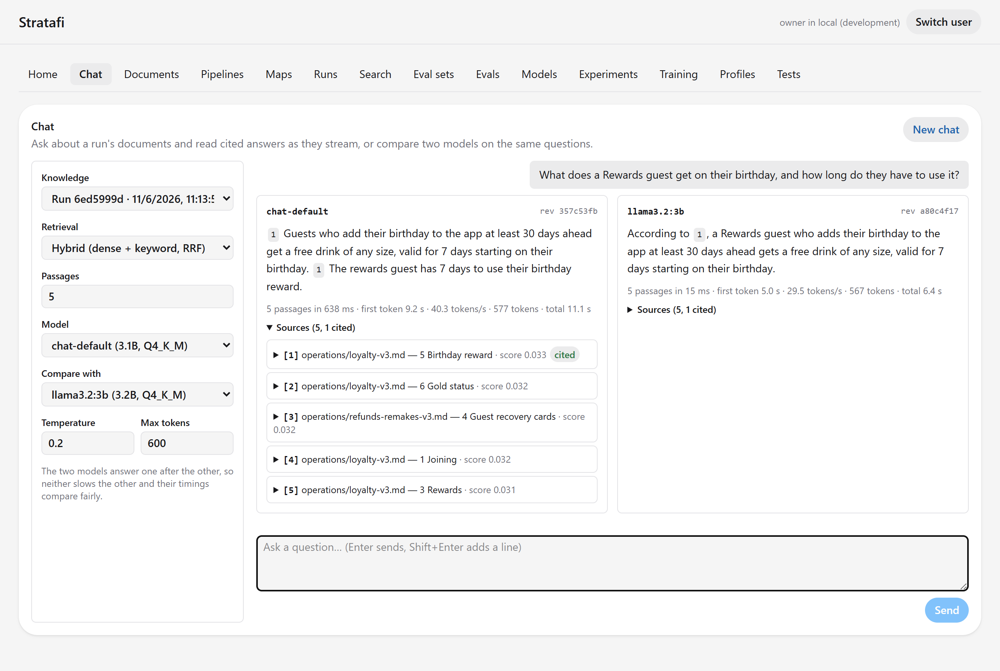
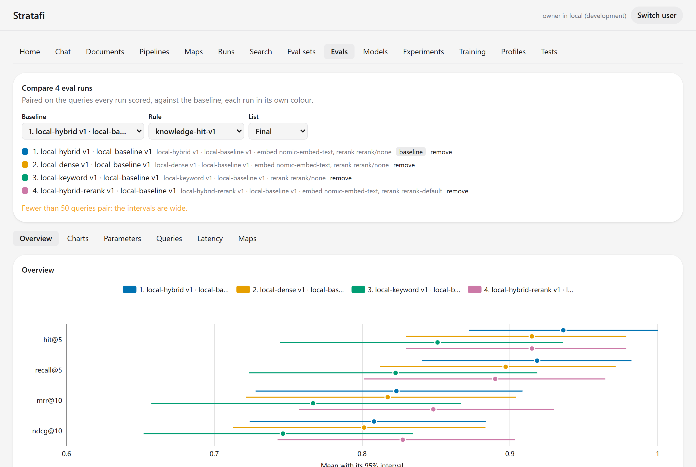
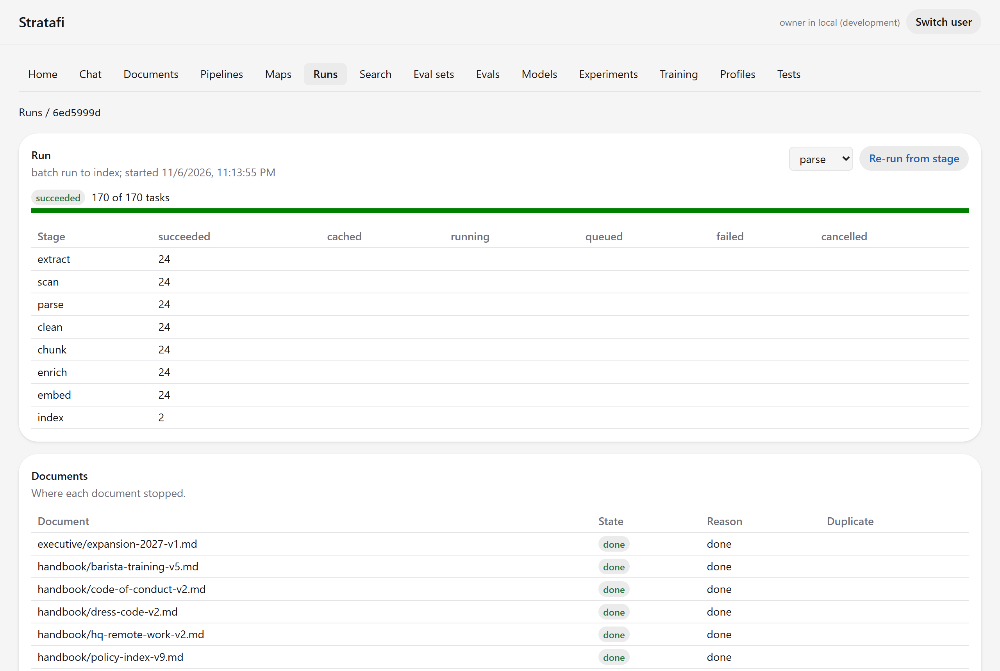
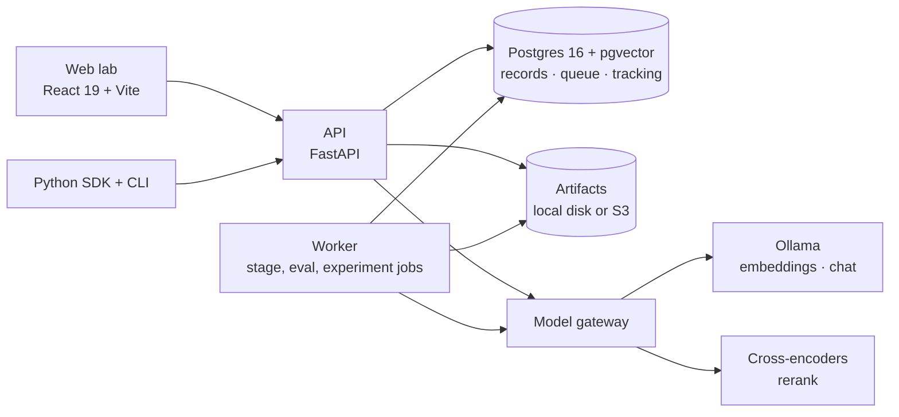

# StrataFi

**A self-hosted lab for building, measuring and chatting with retrieval-augmented generation
(RAG) pipelines, on your own machine, with local models.**

Run each ETL step from a UI (extract, scan and clean, parse, chunk, embed), evaluate retrieval
against a labelled question set with confidence intervals, sweep configurations as experiments,
compare runs side by side like MLflow, fine-tune retrievers on the lab's own evidence, and chat
with any indexed corpus through cited, streaming answers, two models side by side.



## Results on the demo corpus

The repository ships an invented company handbook (**Halcyon Coffee Co.**: 24 documents with
superseded and future-dated versions, tables and manager-only pages) and **88 labelled
questions** (62 dev, 26 held-out test). On the dev split, measured on a laptop (Intel Core
Ultra 7 155U, 32 GB RAM, NVIDIA MX570 4 GB) with the default pipeline (Markdown sections,
200–400-token chunks) and `nomic-embed-text` through Ollama:

| Retrieval | hit@5 | recall@5 | MRR@10 | nDCG@10 |
| --- | --- | --- | --- | --- |
| Hybrid (dense + BM25, RRF k=60) | **0.936** | **0.918** | 0.823 | 0.808 |
| Dense only | 0.915 | 0.897 | 0.817 | 0.801 |
| BM25 only | 0.851 | 0.823 | 0.767 | 0.746 |
| Hybrid + cross-encoder rerank (MiniLM-L6, CPU) | 0.915 | 0.890 | **0.848** | **0.828** |

Reranking the top 50 orders results better (MRR +0.025) but drops one question out of the top 5
and costs about 5 s per query on a CPU: the kind of trade-off the lab exists to surface.

Chat answers from `qwen2.5:3b` (Q4_K_M) stream at about 40 tokens/s on that laptop's 4 GB GPU;
with the model loaded, retrieval takes tens of milliseconds and the first token arrives in 1–3 s.
Comparing two models swaps them in and out of GPU memory, so each answer starts more slowly, as
in the screenshot above.



## What's inside

- **Pipelines as versioned specs.** Every stage is a pluggable component, 67 in all: sources
  from uploads, folders, S3, URLs, ZIP files and email; parsers for PDF, Office files, HTML,
  Markdown and scanned pages (OCR); recursive, semantic, table-aware and parent-child chunkers;
  exact, BM25, Postgres full-text and HNSW indexes; cross-encoder and LLM rerankers. A run
  freezes its corpus version and spec, and **content-addressed caching** reuses every stage
  whose inputs didn't change.
- **Scanning before parsing.** Content checks (the bytes must match the extension, archive and
  size limits, encryption), exact duplicates, ClamAV when a clamd runs, and an **in-process PII
  scanner** that finds validated SSNs, card numbers and IBANs (and emails, phone numbers and IP
  addresses on request) to exclude the document or redact the spans.
- **Evaluation with statistics.** Recall@k, MRR and nDCG with bootstrap confidence intervals,
  paired comparisons with Holm-adjusted deltas, version traps (superseded documents must not
  outrank current ones), ACL checks (manager-only pages must not reach staff) and abstention.
- **Experiments.** Grid and random sweeps and successive halving, with shared work between
  configurations, and a one-shot confirmation on a held-out test split.
- **Tracking like MLflow.** Tags, notes, a search language over runs
  (`metrics.recall@5 > 0.8 and params.rerank.component = 'rerank/none'`), traces per query,
  side-by-side comparison of up to six pipelines, and a map of each pipeline's datastores.
- **Automated tests.** YAML test suites with thresholds, regression checks and golden queries,
  run on triggers, on schedules or in CI with JUnit output, plus a Python SDK and a `stratafi`
  command line.
- **Post-training.** Mine training sets from eval runs (hard negatives included), train a query
  adapter or fine-tune an embedder or cross-encoder, and measure it against its base.
- **Chat.** Grounded, cited answers that stream as server-sent events, with the retrieved
  passages, timings and tokens/s for each answer, and two models side by side.
- **A local model gateway.** One OpenAI-compatible contract for model calls, served by Ollama
  (embeddings, chat) and cross-encoders (rerank). Each Ollama model's **weights digest
  is its revision**, so cached vectors are never mixed across model versions.
- **Engineering details:** a Postgres job queue (`FOR UPDATE SKIP LOCKED`, leases, retries,
  graceful shutdown), row-level security per workspace, sandboxed parsers (seccomp and Landlock
  on Linux), no document text in logs (enforced by canary tests), an OpenAPI contract that
  generates the TypeScript client and the Python SDK's models, and more than 1,500 Python tests
  plus the web app's.



## Quick start

You need Python 3.12 with [uv](https://docs.astral.sh/uv/) 0.13.5, Node 24,
[Ollama](https://ollama.com), and Postgres 16 with pgvector (Docker Compose starts it; on
Windows without Docker, WSL can run it).

```bash
ollama pull qwen2.5:3b && ollama pull nomic-embed-text
uv sync --all-packages --locked && (cd web && npm ci)
uv run python scripts/dev_setup.py          # writes .env with random local secrets
docker compose up -d --wait                 # Postgres; or, on Windows without Docker: scripts/wsl/postgres.sh
uv run python scripts/local.py up           # gateway, API, worker and web app; Ctrl+C stops them
```

Then, in a second terminal, index the demo corpus and evaluate it:

```bash
uv run python scripts/local.py seed
```

Open <http://127.0.0.1:5190/stratafi/> and go to **Chat**. For cross-encoder reranking, add
`--extra rerank` to `uv sync`. Optional services (ClamAV, Apache Tika, SeaweedFS) and a
containerized lab are Compose profiles; the
[local development guide](docs/guides/local-development.md) covers them, the Windows setup and
the tests.

## Architecture



The Python code is one uv workspace: `packages/` (core, components, store, SDK, testing) and
`services/` (API, worker, model gateway). The web app is in `web/`, and the versioned JSON
Schemas and the OpenAPI document are in `contracts/`. [The architecture](docs/architecture.md)
explains how runs, caching, the job queue, evaluation and row-level security work.

## Documentation

- [Architecture](docs/architecture.md): the packages, the pipeline, runs and caching, the job
  queue, the model gateway, evaluation, and security.
- [Local development](docs/guides/local-development.md): setup, the launcher, the demo seed,
  Compose profiles, tests and contracts.
- [Tracking and comparison](docs/guides/tracking-and-comparison.md): the search language,
  Compare, traces, model comparison and pipeline maps.
- [Threat model](docs/security/threat-model.md): what the lab trusts and how it's protected.
- [The demo corpus](fixtures/demo-corpus/README.md): its documents, traps and questions.
- [The SDK and CLI](packages/sdk/README.md).

## Continuous integration

GitHub Actions (`.github/workflows/ci.yml`) runs three jobs on every pull request: Python (ruff,
the unit tier, and checks that the OpenAPI document, the JSON Schemas and the SDK's models are
current), the web app (lint, type check, tests, build, the generated API client and the
performance budgets), and the integration tier against Postgres 16 with pgvector.

## Contributing

Read [AGENTS.md](AGENTS.md): the layout, the commands and the rules every change follows.

## License

The code is under the [MIT License](LICENSE). The demo data, the invented Halcyon Coffee corpus
and its questions in `fixtures/demo-corpus`, is released under
[CC0-1.0](https://creativecommons.org/publicdomain/zero/1.0/).
