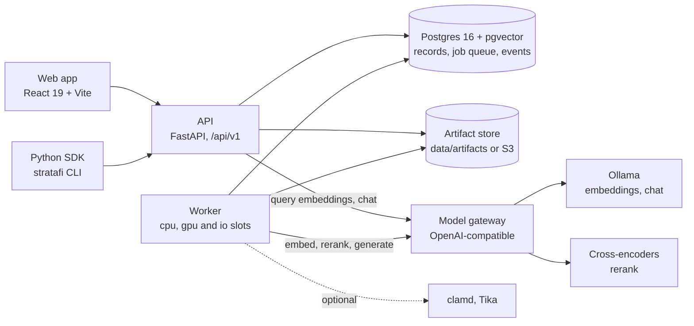

# Architecture

StrataFi is a lab for retrieval-augmented generation (RAG). It turns documents into search
indexes through a pipeline of swappable components, measures how well each index finds known
evidence, and records every run so any two configurations can be compared. It all runs on one
machine.



## Packages and services

The Python code is one uv workspace on Python 3.12; the web app is an npm project.

| Path | What it holds |
| --- | --- |
| `packages/core` | Specs, canonical hashing, the component interface, relevance rules, metrics, statistics, settings, identity tokens, logging. Everything else depends on it |
| `packages/components` | The 67 built-in components, the parse sandbox, the URL guard and the gateway client |
| `packages/store` | Tables, the migration, the job queue, the artifact store, row-level security, purge and backup |
| `packages/sdk` | The Python client and the `stratafi` command, with models generated from the OpenAPI contract |
| `packages/testing` | The pytest plugin: tier gating, throwaway databases, fakes, the canary check |
| `services/api` | The REST API under `/api/v1`, server-sent events, the development sign-in, chat |
| `services/worker` | Runs jobs: stage tasks, eval shards, experiments, test runs, training, webhooks |
| `services/gateway` | The local model gateway over Ollama and cross-encoders |
| `web` | The UI: `src/lab` holds the screens behind a host adapter, `src/standalone` hosts them at `/stratafi/` |

`contracts/` holds the OpenAPI document and 18 versioned JSON Schemas (`stratafi.<name>.vN`)
with fixtures.

## Pipelines and specs

A pipeline has eight stages, which the UI groups into five steps: **Extract** (`extract`),
**Scan + Clean** (`scan`, and `clean` after Parse), **Parse** (`parse`), **Chunk** (`chunk`,
`enrich`) and **Embed** (`embed`, `index`). Scan runs before any parser opens a file; Clean
needs text, so it runs after Parse. Each stage writes an artifact: a raw document, a scan report,
a parsed document (elements, pages, tables), a cleaned document, chunks as JSONL, vectors, and a
dense and a keyword index.

A **pipeline spec** (`stratafi.pipeline.v1`) names a component and its parameters for each
stage, with a parser per file type. Every field has a default:

```yaml
schema: stratafi.pipeline.v1
name: local-baseline
stages:
  scan: {checks: [{component: scan/content-safety}, {component: scan/dedupe}]}
  chunk: {component: chunk/sections, params: {max_tokens: 400, min_tokens: 200}}
  embed: {component: embed/gateway, params: {alias: nomic-embed-text}}
  index: {dense: {component: index/exact}, keyword: {component: index/bm25}}
```

A **retrieval config** (`stratafi.retrieval.v1`) says how a query searches: dense and keyword
retrievers, fusion (`rrf`, `weighted` or `none`), the candidate pool, filters (collections,
versions in effect on a date), a reranker and `top_k`. Both are versioned by name, and one
validator serves the API, the UI, the SDK and the experiment planner. It checks that every
component exists in its stage, that parameters validate, that each file type has a parser that
accepts it, that `scan/content-safety` runs, and that infected files are excluded.

Each **component** declares an ID such as `parse/docling`, a version, a parameter model (its
JSON Schema drives the UI's forms and sweeps), a resource class, a license, and its egress:
`none`, `model_gateway` or `provider:<name>`.

**Eval sets** (`stratafi.eval-set.v1`) hold questions whose gold evidence is a document version,
a section and a phrase, never a chunk, so one set scores any parser and chunker. Items carry an
asker checked against document ACLs, versions to `avoid`, documents that must never return, and
a `dev` or `test` split.

## Runs, frozen corpora, artifacts and caching

Documents are stored once per workspace, by SHA-256. `freeze` snapshots a corpus as an
immutable version. A **run** is one pipeline spec version over one frozen corpus version,
optionally up to a stage and on a sample.

Every stage output is an immutable artifact addressed by its **cache key**: a SHA-256 over the
stage, the component's ID and version, its resolved parameters, its inputs' keys, and what else
changes the output, such as the model's revision. The worker plans each document one task at a
time: a task whose artifact exists is `cached`, and the first that doesn't becomes a job. An
identical second run is all cache hits, and experiment trials share every stage they have in
common. Artifacts live under `ws/<workspace>/artifacts/<cache-key>`, on disk under
`data/artifacts` or in any S3 API, with their lineage in Postgres. A component bumps its version
whenever its output could change.

Each run's manifest (`stratafi.run-manifest.v1`) records its configuration, inputs, models,
environment, hardware, per-task timings, cost, egress and outputs. Its hash is the run's
fingerprint.

## The job queue

Jobs live in Postgres, with no separate broker. A worker slot claims the next due job of its
resource class with `SELECT ... FOR UPDATE SKIP LOCKED`, so two workers never claim the same job.

- **Slots:** `worker.slots` sets threads per class: `cpu: 2`, `gpu: 1` (in-process models and
  fine-tuning) and `io: 4` (remote calls).
- **Leases:** a claim starts a 60-second lease that a heartbeat renews every 15 seconds. A job
  whose worker died returns to the queue when its lease runs out.
- **Retries:** exponential backoff with jitter, at most 3 attempts. Stage tasks are idempotent,
  since a retried task finds its artifact already written.
- **Shutdown:** SIGTERM stops new claims, gives running jobs 30 seconds, then hands them back
  without using up an attempt.
- **Events:** every change notifies `stratafi_events` in its transaction, and the API streams
  `LISTEN`/`NOTIFY` to the UI and the SDK as server-sent events.
- **Rate limits** per provider are shared by every worker process through Postgres.

## The model gateway contract

Model calls go through one OpenAI-compatible contract, by default to the local gateway on
`127.0.0.1:8091`:

| Route | Used for |
| --- | --- |
| `GET /v1/models` | Each model's `purpose` (`embed`, `chat`, `rerank`), `revision` and dimensions |
| `POST /v1/embeddings` | Embedding chunks and queries, OpenAI's shape |
| `POST /v1/chat/completions` | Chat, answer generation, chunk context and listwise reranking; streams as server-sent events |
| `POST /v1/rerank` | Cross-encoder reranking, Cohere's shape |

Every model response carries the model's revision in an `X-Model-Revision` header: for an Ollama
model, its weights' digest. The revision goes into every embedding's cache key, and a missing
or changing revision is an error, so vectors from two sets of weights never mix. The gateway
serves each pulled Ollama model by name, plus aliases such as `embed-default` and
`chat-default`, and cross-encoders with its `rerank` extra. Tests use a fake gateway that serves
the same contract.

In-process models are lab-only, behind `models.in_process`. Hosted providers refuse to run until
`providers.allowed` names them, and each run records which providers received which documents.

## Evaluation and comparison

An **eval run** scores one run's index with one retrieval config on one eval set split. Each
query is searched as its asker, on the set's as-of date, and its ranked list is kept at every
checkpoint: dense, keyword, fused, candidates, reranked and final.

- **Relevance:** three rules side by side. `knowledge-hit-v1` counts a chunk of the expected
  version whose section matches or whose text holds the evidence phrase;
  `evidence-coverage-v1` grades how much of the phrase a chunk covers, which feeds nDCG; `doc-v1`
  counts any chunk of the expected version. Findability checks that the evidence survived
  parsing at all.
- **Metrics:** hit@k, recall@k, MRR@k and nDCG@k at every checkpoint, rerank uplift, `avoid`
  and `must_not_return` violations, abstention and latency per step.
- **Statistics:** 95% bootstrap intervals over queries. Comparisons are paired on the same
  queries, with a sign-flip randomization test and Holm's adjustment across many comparisons.
- **Experiments** (`stratafi.experiment.v1`) sweep factors by grid, random search or successive
  halving, within a budget. The winner is confirmed once on the locked test split, and every
  test-split read is counted.
- **Knowledge profiles** export a confirmed trial: its spec, config, models and evidence.

**Test suites** (`stratafi.test-suite.v1`) assert thresholds, regressions, golden queries and
budgets. They run from CI, on schedules or on triggers, and report as JSON, JUnit XML and
Markdown. Custom Python checks run only in a sandbox container. **Tracking** adds titles, tags,
notes, MLflow's search language, comparisons of up to six runs, traces, model comparisons and
pipeline maps ([tracking and comparison](guides/tracking-and-comparison.md)).

**Chat** (`POST /api/v1/chat`) retrieves passages from a run's index, numbers them, and streams
a cited answer from a gateway chat model as server-sent events, with its timings. Nothing is
stored. **Post-training** mines training sets from dev eval runs and trains query adapters or
fine-tunes embedders and cross-encoders, which are then evaluated like any other configuration.

## Tenancy, identity and row-level security

Every table carries a `workspace_id`, and every object key a workspace prefix. The API takes a
short-lived EdDSA token in `X-Stratafi-Identity`, signed with the development key. The web app
and the SDK get one from the development sign-in as the local owner, `local:owner`, and the
token's tenant names the workspace.

Row-level security is on, and forced on the tables' owner, for every workspace table. A row is
visible when the transaction's `stratafi.workspace_id` matches it, or its `stratafi.scope` is
`system`; both are set transaction-locally on every transaction. The API sees nothing until a
request names its workspace, each job sees only its own, and the command line runs as `system`.
Services connect as the `stratafi` role, never as a superuser, which would skip the policies.
This catches a query that forgets its workspace filter; it isn't a boundary against code that
sets its own scope.

## No text in logs

Document, chunk and query text never goes into logs, metrics, audit events, job progress, events
or error messages: only IDs, hashes, codes and counts.

- Log messages are fixed format strings, and errors carry codes and field paths, never values.
- The JSON log formatter is a backstop: fields named like content become `[redacted]`,
  sentence-like values become `[text redacted]`, and exceptions lose their messages.
- Postgres runs with `log_min_error_statement=panic`, and uvicorn's access log is off.
- The packages, the API and the worker have **canary tests**: they plant a unique value where
  text would go, run the code, and assert the value reaches no log, stdout, stderr, response or
  event. A unit test, like `scripts/security_report.py canaries --check`, fails when one of them
  has none. The model gateway logs only endpoints, models, counts and timings, and has no canary
  test yet.

## Further reading

- [Local development](guides/local-development.md): setup, the launcher, tests and contracts.
- [Tracking and comparison](guides/tracking-and-comparison.md): search, compare, trace, maps.
- [Threat model](security/threat-model.md): what the lab trusts and how it's protected.
- [The SDK](../packages/sdk/README.md) and [the demo corpus](../fixtures/demo-corpus/README.md).
